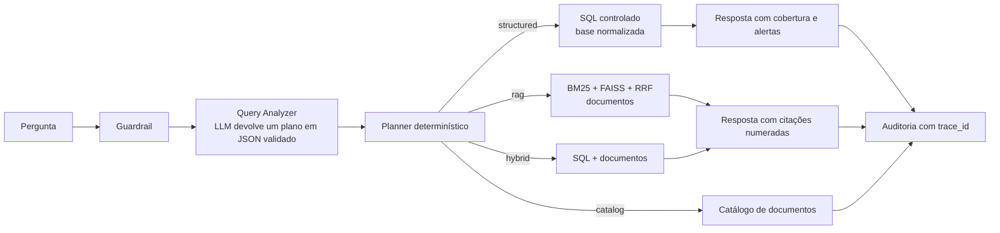

# Assistente RAG para Contratações Públicas do Estado do Rio de Janeiro

Um assistente que responde, em linguagem natural, perguntas sobre contratações públicas do Estado do Rio de Janeiro e sobre a legislação de licitações (Lei 14.133/2021, decretos e editais). Cada pergunta é analisada e enviada para o caminho certo: uma consulta SQL controlada sobre dados do PNCP, uma busca em documentos com citações, ou as duas juntas.

Projeto desenvolvido pelo **Time 03** na residência **TIC em Trilhas** (PUC-Rio / Instituto ECOA). Esta é a minha cópia individual para portfólio; os créditos de toda a equipe estão no fim deste arquivo.

> **Vídeo de demonstração (até 5 min):** link a ser adicionado aqui.

---

## O problema

Os dados de contratações públicas estão espalhados em contratos, atas, planos anuais e documentos longos (editais, leis, termos de referência). Perguntas simples, como "quantas contratações houve por modalidade em 2026?" ou "o que a lei diz sobre dispensa de licitação?", exigem abrir várias fontes e cruzar tudo à mão. Um chat comum, sem acesso aos dados, inventa números e artigos.

## A solução: Adaptive RAG

O sistema não deixa o modelo de linguagem escrever SQL nem responder de memória. A pergunta passa por etapas, e cada uma tem um papel:



- **Guardrail:** recusa pedidos de recomendação de empresas e perguntas fora do escopo.
- **Query Analyzer:** a LLM só classifica a pergunta e devolve um plano em JSON, que é validado por schema. Planos inválidos viram erros explicáveis (HTTP 422).
- **Planner e ferramentas:** escolhem a rota de forma determinística. O SQL sai de um construtor próprio, sem texto livre da LLM.
- **Respostas verificáveis:** consultas estruturadas trazem avisos de cobertura dos dados; consultas documentais trazem citações numeradas; tudo fica registrado com `trace_id`.

## As quatro bases

| Base | Conteúdo | Como é consultada |
|---|---|---|
| Normativa | 13 documentos (Lei 14.133, decretos, editais), 794 trechos | busca híbrida BM25 + FAISS + RRF |
| Estruturada | contratações, contratos, itens, resultados do PNCP | SQL controlado |
| Agregada | atas de registro de preços, PCA, valores homologados | SQL controlado |
| Conversacional | atas e e-mails sintéticos | recuperação documental |

Na avaliação interna da base normativa (7 perguntas com fonte esperada), a busca híbrida acertou a fonte em 6 de 7 no top 3 e em 7 de 7 no top 10.

## Tecnologias

Python · FastAPI · Uvicorn · SQLAlchemy · SQLite (FTS5) · FAISS · Pydantic · Streamlit · PyJWT e Argon2 (login) · Pytest. Modelos: embeddings e geração pelo servidor do ECOA, ou pela OpenAI com uma chave própria.

---

## Como instalar e executar

Requisitos: Python 3.12 ou superior (testado com 3.14) e Git.

```bash
git clone https://github.com/anakarinagestao/rag-contratacoes.git
cd rag-contratacoes

python -m venv .venv
# Windows (PowerShell): .\.venv\Scripts\Activate.ps1
# Linux/macOS:          source .venv/bin/activate

pip install --upgrade pip
pip install -r requirements.txt
pip install -r requirements-dev.txt   # inclui Streamlit e pytest
```

### 1. Configurar o `.env`

```bash
cp .env.example .env
```

Preencha pelo menos:

```dotenv
DATABASE_URL=sqlite:///./app.db
JWT_SECRET_KEY=<gere abaixo>
```

```bash
python -c "import secrets; print(secrets.token_urlsafe(48))"
```

A chave precisa ter pelo menos 32 bytes. O `.env` nunca vai para o Git.

**Modelos de linguagem.** Escolha um caminho:

- **OpenAI (para quem está fora do curso):** informe `OPENAI_API_KEY` e use `LLM_PRIMARY_PROVIDER=openai` e `EMBEDDING_PROVIDER=openai` (veja `.env.example` e [docs/FAISS_OPENAI_PILOT.md](docs/FAISS_OPENAI_PILOT.md)). A geração de embeddings gera custo na sua conta.
- **Servidor do ECOA:** padrão do projeto, disponível apenas para participantes do programa.

### 2. Criar o banco e carregar a base normativa

```bash
python -m app.init_db
python -m app.modules.normative.persistencia --versao v1
```

Isso cria as tabelas e grava 794 trechos em 13 documentos. Os trechos já vêm processados em `data/processed/v1_editais_normativo.jsonl`, e os documentos de origem estão em `data/manual/`. A busca por palavras-chave (BM25) já funciona nesse ponto.

### 3. Índice vetorial (opcional, para a busca por significado)

Gere os vetores com o provedor escolhido, em um diretório de staging (detalhes e limites de custo em [docs/FAISS_OPENAI_PILOT.md](docs/FAISS_OPENAI_PILOT.md)):

```bash
python -m src.base_estruturada.pipelines.pipeline_indexacao_faiss \
  --base-id editais_normativo --ate-concluir \
  --indice-dir data/index/faiss/staging/meu-indice
```

Depois aponte `RAG_FAISS_INDEX_DIR` para esse diretório no `.env`. Um índice gerado com um provedor nunca deve ser misturado com o de outro.

### 4. Dados do PNCP (opcional, para perguntas estruturadas)

As rotas `structured` leem uma base normalizada, gerada a partir de um snapshot RAW do PNCP. A coleta e a normalização estão em [docs/GUIA_EXECUCAO_PIPELINES_PNCP.md](docs/GUIA_EXECUCAO_PIPELINES_PNCP.md). Com um RAW disponível:

```bash
python -m src.normalize_pncp \
  --raw-database caminho/para/raw.db \
  --output-database data/normalized/pncp_rj_normalized.db
```

e configure `NORMALIZED_DATABASE_URL=sqlite:///./data/normalized/pncp_rj_normalized.db`. Em um teste com 79 mil registros RAW, a normalização levou cerca de 30 segundos.

### 5. Criar um usuário e subir a aplicação

```bash
python -m app.create_admin
python -m uvicorn app.main:app --reload
```

Em outro terminal:

```bash
python -m streamlit run app/streamlit_console.py
```

- API e Swagger: http://127.0.0.1:8000/docs
- Console de perguntas: http://127.0.0.1:8501 (entre com o usuário criado)

## Exemplos de perguntas

| Pergunta | Rota |
|---|---|
| Quantas contratações existem por modalidade em 2026? | `structured` |
| Qual o valor total dos contratos assinados em 2026? | `structured` |
| Qual a diferença entre dispensa e inexigibilidade de licitação? | `rag` (cita a Lei 14.133) |
| Qual a melhor empresa para eu contratar? | recusada pelo guardrail |
| Qual é a capital da França? | recusada como fora do escopo |

## Testes

```bash
export DATABASE_URL=sqlite:///./teste.db JWT_SECRET_KEY=<chave de teste>
python -m pytest tests -q
```

Na última execução, 810 testes passaram. Há 16 falhas conhecidas, já presentes no projeto original (geração com "thinking", observabilidade de HTTP, sanitização e inventário de escopo), e 1 teste que depende de dados locais. Estão listadas na seção de limitações.

## Limitações conhecidas

- O Query Analyzer depende da LLM e às vezes devolve um plano inválido; a mesma pergunta pode responder numa rodada e falhar em outra.
- Agrupamentos por mês ("contratos assinados por mês") respondem, mas agrupam por data exata de assinatura.
- Na rota de documentos, algumas perguntas amplas respondem "sem informação suficiente", mesmo com trechos relevantes recuperados.
- A recusa por "fora do escopo" usa vocabulário do domínio; uma pergunta fora do tema que use termos como "valor" ou "item" cai no erro 422.
- A cobertura dos dados é parcial; as respostas estruturadas sempre mostram esse aviso.
- Os dados e índices usados na apresentação não estão neste repositório (dados do PNCP e índices são grandes demais para o Git).

## Estrutura

```text
app/          API FastAPI: autenticação, consulta, documentos, console Streamlit
src/          Pipeline: guardrails, analisador, planner, SQL tool, recuperação híbrida, geração, auditoria
config/       inventário de escopo e política de coleta
data/         manifesto, trechos processados e documentos normativos de origem
docs/         guias operacionais e documentação técnica (começa em docs/REFERENCIA_TECNICA.md)
eval/         perguntas de referência para avaliação
tests/        testes unitários e de integração
```

## Créditos

O projeto foi construído em equipe. A divisão abaixo resume o foco de cada pessoa; os usernames vêm do histórico de commits do repositório do grupo.

| Pessoa | Foco |
|---|---|
| Ana Karina [@anakrinagestao](https://github.com/anakarinagestao) | base normativa, demonstração e ajustes deste repositório |
| Ester Neves [@EsterNevess](https://github.com/EsterNevess) | base normativa (com Ana Karina), demonstração e ajustes do analisador, das mensagens de erro e das recusas.
| Ana Karina | base normativa |
| Alisson Lima | base estruturada, roteamento e índice consolidado |
| Luciano Oliveira | base estruturada e melhorias do RAG |
| Renan | base agregada, integração do Adaptive RAG e demonstração |
| Luiz Felipe Antunes | base agregada |
| Marcio Oliveira | base conversacional, guardrails e prompts |

Instituições: PUC-Rio e Instituto ECOA, programa TIC em Trilhas. Os dados vêm do Portal Nacional de Contratações Públicas (PNCP) e das fontes oficiais listadas em `corpus_manifest.yaml`.

Ajustes feitos : erros de plano explicáveis (HTTP 422) em vez de 503, correção da data de assinatura por entidade, guardrail antes do analisador e recusa por escopo.
