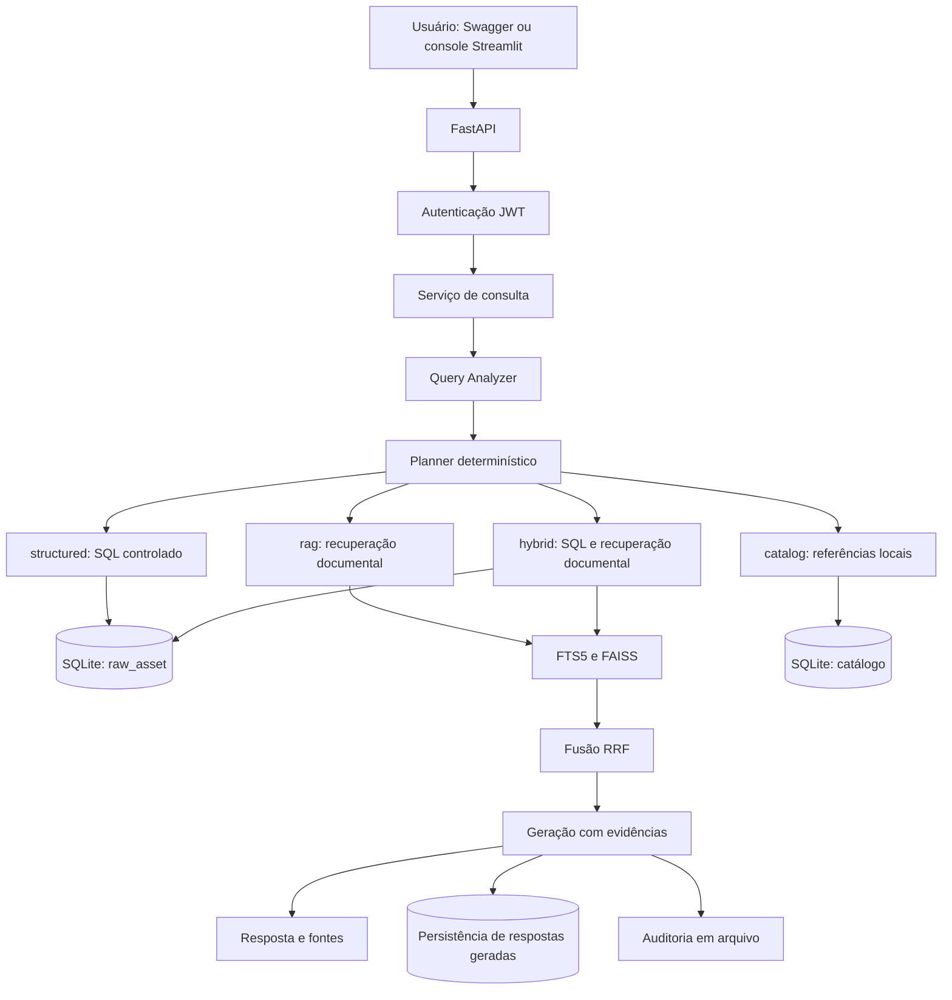
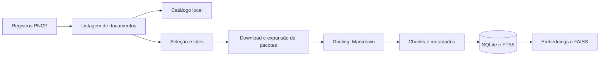
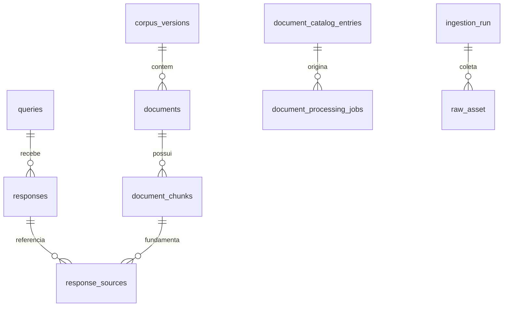

# Análise geral do projeto — Contratações Públicas RJ

**Data da análise:** 19/10/2026.  
**Atualização sobre bases normalizadas e cobertura:** 23/10/2026.
**Projeto:** Grande Desafio de IA Generativa e RAG — Grupo 03.  
**Escopo:** estrutura do repositório, código da aplicação, pipelines, contratos de dados, configurações de exemplo, testes e documentação disponível.

Este documento explica o projeto a partir da implementação encontrada. Quando uma capacidade existe apenas nos requisitos ou na arquitetura proposta, isso é indicado explicitamente. A análise é estática: não certifica disponibilidade do PNCP ou da ECOA, qualidade das respostas, cobertura do banco local nem funcionamento completo em execução. Não foram lidos segredos do `.env` nem alterados banco, índices ou dados coletados.

## Atualização de 23/10/2026: base normalizada, release e cobertura

Esta seção atualiza especificamente as informações sobre consultas SQL, seleção de banco e cobertura. As demais seções preservam o diagnóstico original de 19/10/2026; referências históricas à consulta SQL diretamente na RAW ou à limitação da ferramenta a duas entidades não descrevem o fluxo normalizado atual.

### Base oficial e versão distribuída na release

O arquivo `data/normalized/pncp_rj_normalized.db` é a base oficial privada documentada na Fase 3. A release distribui uma **cópia sanitizada derivada dessa base**, com nome diferente; não distribui o arquivo privado original com esse mesmo nome.

| Artefato | Papel | Situação local verificada em 23/10/2026 |
| --- | --- | --- |
| `data/normalized/pncp_rj_normalized.db` | Base oficial privada | Não encontrada no workspace |
| `data/normalized/releases/pncp_rj_normalized_public_20261020.sqlite.gz` | Cópia sanitizada compactada, documentada como anexo da release | Não encontrada; diretório `releases` também ausente |
| `data/normalized/pncp_rj_local_parcial_20261023.db` | Base parcial gerada a partir da RAW local | Existente e selecionada na configuração local verificada |
| `app.db` | Banco operacional, documentos e RAW | Não possui o esquema normalizado exigido pelo SQL Tool |
| `app_normativa.db` | Documentos normativos e estruturas operacionais | Não possui o esquema normalizado exigido pelo SQL Tool |

A publicação documentada está na tag [`base-normalizada-pncp-rj-20261020-v1`](https://github.com/grande-desafio-ia-rag-03/rag-grande-desafio-grupo03-contratacoes-publicas/releases/tag/base-normalizada-pncp-rj-20261020-v1). Segundo o registro local da Fase 5, os anexos são:

- `pncp_rj_normalized_public_20261020.sqlite.gz`;
- `release_manifest.json`;
- `SHA256SUMS.txt`.

O pacote documentado tem 504.234.659 bytes e SHA-256 `fa28e5c8e2a15f947e47fc1c66326a842ad095cc39c706dbaab60e9f41f585b7`. O banco descompactado tem SHA-256 `dda99f3218477342e3c034ffa93f78b5c845d03f7ed4e84367cc8bf49279dcfb`. Esses valores identificam a versão sanitizada de 20/10/2026, não o banco privado nem a base parcial local.

A existência da publicação foi obtida da documentação do repositório, sem nova consulta ao GitHub. A ausência do pacote no workspace não significa ausência na release remota. Nenhum download ou troca de base foi realizado nesta atualização.

### Banco selecionado e evidência da conexão

A configuração local verificada é:

```dotenv
NORMALIZED_DATABASE_URL=sqlite:///./data/normalized/pncp_rj_local_parcial_20261023.db
```

O serviço abre a conexão por `app/modules/query/services.py::_normalized_connection`, que usa `readonly_sqlite_connection` com `mode=ro` e `PRAGMA query_only=ON`. Essa conexão é entregue a `src/query/normalized_structured_tool.py`; a sessão operacional de `app.db` não é usada como fallback para SQL estruturado.

Uma conexão de diagnóstico aberta pelo mesmo gerenciador, sem sobrescrever a URL, retornou em `PRAGMA database_list`:

```text
main: <raiz-do-projeto>\data\normalized\pncp_rj_local_parcial_20261023.db
```

Na mesma conexão, `PRAGMA query_only` retornou `1`, e o SQL Tool retornou `count=37637`, com `coverage.state=partial`. O usuário também informou esse resultado em `POST /query/structured`. A inspeção do `PRAGMA` foi feita em um processo de diagnóstico: **não constitui inspeção da conexão interna do Uvicorn ativo**. Não se deve apresentar a configuração carregada pelo processo ativo como definitivamente comprovada apenas por essa evidência.

### Validação e limites da base parcial

A base foi gerada separadamente, usando um snapshot consistente criado pela API de backup do SQLite em `data/debug/app_raw_snapshot_20261023.db`.

| Entidade | Registros na normalizada parcial |
| --- | ---: |
| Contratações | 37.637 |
| Contratos | 41.978 |
| Órgãos | 528 |
| Unidades | 1.310 |
| Fornecedores | 12.996 |
| Itens, resultados por item, atas, PCA, itens de PCA e empenhos | 0 |

A execução `f46c7fce-708c-472e-846c-69b26a232f18` terminou com `SUCCESS`, 79.615 registros RAW examinados, 94.449 entidades normalizadas, zero rejeições e zero problemas registrados. Snapshot e normalizada passaram no `integrity_check`; a normalizada não apresentou violações em `foreign_key_check`. Chaves, relacionamentos, linhagens e seis campos financeiros foram reconciliados com a RAW sem divergências. O relatório local está em `data/normalized/pncp_rj_local_parcial_20261023_validacao.json`.

Existem 24.576 contratos cuja contratação-pai está fora do recorte e dois contratos sem identificador de fornecedor. Essas limitações refletem os dados de origem; sucesso da transformação não equivale a completude da coleta.

### Proteção de cobertura nas respostas

O resultado SQL agora inclui `coverage`, avaliado por `src/query/coverage.py`, com estados `covered`, `partial`, `unavailable` e `unknown`. A avaliação considera os metadados existentes, as contagens disponíveis e dependências entre recursos, especialmente contratos e contratações.

`normalization_coverage.coverage_status=COMPLETE`, isoladamente, não comprova cobertura integral do PNCP. Nesta base, alguns recursos vazios foram marcados como completos em relação ao snapshot. Períodos e contagens de pais esperados/processados não foram preenchidos. Portanto, zero, `SUM=NULL` e listas vazias não podem ser interpretados como inexistência no universo consultado. Resultados positivos também recebem ressalvas quando a cobertura é parcial ou não comprovada.

Os compositores structured e hybrid incluem avisos de cobertura por código. A geração hybrid não pode considerar a simples presença de um resultado SQL como substituto de evidência documental. A validação offline dessa implementação registrou 102 testes e três subtestes aprovados, sem LLM ou embeddings externos. Isso não certifica o fluxo completo com provedores reais.

### Como utilizar outra base

Para consumir a release sanitizada, é necessário obter o pacote, verificar os hashes publicados e descompactá-lo para um arquivo SQLite novo. Antes de selecionar a base, validar integridade, chaves estrangeiras, esquema obrigatório e última execução de `normalization_run` com `SUCCESS`, além do manifesto e dos limites de cobertura. O `.gz` não é aberto diretamente pela conexão SQLite da aplicação.

Depois dessas verificações, `NORMALIZED_DATABASE_URL` deve apontar para o arquivo descompactado. A aplicação seleciona uma normalizada por vez; não combina automaticamente a oficial, a release e a parcial. Renomear a parcial para o nome da oficial não amplia sua cobertura. O reinício precisa considerar que o lifespan padrão também executa inicialização de esquema no banco operacional.

Referências: [base oficial — Fase 3](../docs/FASE_3_BASE_NORMALIZADA_OFICIAL.md), [sanitização — Fase 4](../docs/FASE_4_EXPORTACAO_NORMALIZADA_SANITIZADA.md) e [publicação — Fase 5](../docs/FASE_5_PUBLICACAO_RELEASE_NORMALIZADA.md).

## 1. O que o projeto faz

O sistema permite consultar informações sobre contratações públicas do Rio de Janeiro em linguagem natural. Ele reúne registros do Portal Nacional de Contratações Públicas (PNCP), documentos das contratações e textos normativos para responder perguntas com dados e fontes identificáveis.

O diferencial é decidir como responder antes de executar a busca. Uma pergunta sobre quantidade de contratos precisa de uma consulta ao banco; uma pergunta sobre uma cláusula precisa do texto do documento. Perguntas que combinam as duas necessidades usam ambas as fontes.

Exemplos de uso:

| Necessidade | Estratégia apropriada |
| --- | --- |
| Contar contratações por modalidade e ano | Consulta SQL com filtros e agrupamento |
| Identificar exigências em um edital | Recuperação de trechos documentais e geração fundamentada |
| Cruzar valores de contratos com cláusulas dos documentos | SQL seguido de recuperação documental |
| Descobrir se um edital está listado e obter seu link | Consulta ao catálogo local de documentos |

O sistema responde sobre os dados efetivamente coletados e processados. A existência de um registro no PNCP não significa que seu documento esteja disponível para leitura pelo RAG.

## 2. Conceitos necessários para entender a solução

| Conceito | Significado no projeto |
| --- | --- |
| RAG | Recuperar evidências antes de pedir ao modelo que produza uma resposta |
| Adaptive RAG | Escolher a estratégia de consulta conforme a pergunta |
| Corpus | Conjunto de registros e documentos usados como fonte |
| RAW | Registro original coletado, acompanhado de origem, hash e informações de ingestão |
| Chunk | Trecho de documento persistido com identificador e metadados |
| Embedding | Representação numérica usada para comparar significados |
| FAISS | Índice persistido que permite busca vetorial |
| FTS5/BM25 | Busca lexical do SQLite com ordenação por relevância |
| RRF | Fusão determinística dos rankings lexical e vetorial |
| Catálogo | Referências aos arquivos anunciados pelo PNCP, mesmo sem conteúdo processado |
| Checkpoint | Estado salvo para retomar uma coleta ou processamento |
| Guardrail | Regra de segurança ou escopo aplicada ao fluxo |

## 3. Arquitetura geral

A aplicação combina uma API FastAPI, um banco SQLite, índices locais, serviços de modelo de linguagem e processos de preparação dos dados.



O diagrama resume os caminhos principais; as condições de persistência e as limitações de segurança são detalhadas adiante. O endpoint `/query/generate` também permite entrar diretamente no fluxo RAG sem passar pelo Analyzer adaptativo.

### 3.1 Separação entre aplicação e componentes técnicos

- `app/`: API, autenticação, administração, modelos persistentes, contratos HTTP e serviços de aplicação.
- `src/`: coleta, análise da pergunta, planejamento, consulta estruturada, chunking, indexação, recuperação, geração e auditoria.
- `data/`: artefatos produzidos nas diferentes etapas da preparação do corpus.
- `tests/`: testes automatizados de componentes, coleta e integração.
- `docs/`: guias operacionais e documentação técnica complementar.

O padrão predominante dos módulos de domínio é `model.py`, `schemas.py`, `services.py` e `routes.py`. Há módulos incompletos e exceções; a presença da pasta não prova que uma funcionalidade esteja exposta na API.

## 4. Mapa do repositório

| Caminho | Responsabilidade |
| --- | --- |
| `app/main.py` | Criação da API, ciclo de inicialização e registro dos routers |
| `app/core/config.py` | Configurações Pydantic e resolução do diretório FAISS |
| `app/core/security.py` | Hash de senha, JWT, usuário autenticado e autorização administrativa |
| `app/core/database/` | Conexões SQLite/SQLAlchemy, criação de tabelas e repositórios RAW |
| `app/core/llm_provider.py` | Provedor de geração/análise e fallback configurável |
| `app/core/faiss_startup.py` | Verificação do índice selecionado ao iniciar a API |
| `app/core/logging.py` | Logs e medição de etapas da consulta |
| `app/core/llm_http_observability.py` | Observabilidade das chamadas HTTP aos modelos |
| `app/modules/auth/` | Cadastro, login e consulta ao usuário autenticado |
| `app/modules/admin/` | Criação, listagem e alteração de estado de usuários |
| `app/modules/query/` | Endpoints de consulta, coordenação adaptativa e persistência de respostas |
| `app/modules/documents/` | Documentos, chunks, catálogo e fila de processamento |
| `app/modules/documents/worker.py` | Processamento documental em processo separado |
| `app/modules/rag/` | Serviço de recuperação e modelo de eventos do pipeline |
| `app/modules/normative/` | Coleta normativa, inventários e versionamento |
| `app/modules/ingest/` | Extração e preparação normativa, incluindo mascaramento de dados pessoais |
| `app/modules/corpus/`, `history/`, `feedback/` | Estruturas de domínio com implementação HTTP ainda incompleta |
| `app/streamlit_console.py` | Cliente HTTP local para validar as consultas |
| `src/query/` | Analyzer, schemas, Planner, executores e Structured Tool |
| `src/ingestion/` | Clientes e coletores PNCP orientados ao manifesto e à camada RAW |
| `src/base_estruturada/pncp/` | Coleta e manipulação de registros e documentos PNCP |
| `src/base_estruturada/pipelines/` | Etapas operacionais de processamento e persistência |
| `src/base_estruturada/pipelines/experimentos/` | Experimentos de extração e comparação de ferramentas |
| `src/rag/` | Representações de documentos/chunks e utilitários de ingestão textual |
| `src/inspection/` | Inspeção do manifesto, banco RAW e prévias de dados PNCP |
| `src/index.py`, `src/fts.py`, `src/retrieve.py` | Indexação vetorial, índice lexical e recuperação híbrida |
| `src/generate.py` | Contexto, prompt, geração, persistência e auditoria do RAG |
| `src/audit/` | Serialização e sanitização de traces |
| `llm_ecoa.py` | Cliente compatível com OpenAI apontando para o serviço ECOA/Ollama |
| `notebooks/` | Processamento documental com Docling no Colab |
| `acompanhamento/` | Registros de acompanhamento do trabalho da equipe |
| `eval/` | Espaço reservado para avaliação; arquivos centrais ainda vazios |
| `teste.py`, `teste_api_ecoa.py`, `visualizar_pncp.py` | Scripts auxiliares da raiz; não são o ponto de entrada da API |

## 5. As quatro naturezas de evidência

As bases lógicas representam o tipo de informação necessário, enquanto as rotas representam como executar uma consulta. São dimensões diferentes.

| Base lógica | Conteúdo esperado | Situação observada |
| --- | --- | --- |
| Normativa | Leis, decretos, regulamentos e editais | Coleta, processamento e persistência próprios; identificador documental `editais_normativo` |
| Estruturada | Contratos e contratações com campos como órgão, valor e ano | Consulta SQL sobre RAW e documentos enriquecidos com metadados |
| Agregada | Totais, médias, contagens e indicadores | Cálculos SQL implementados para contratos/contratações; frente de coleta mais ampla que a ferramenta de consulta atual |
| Conversacional | Atas, comunicações e outros registros textuais | Identificadores previstos no catálogo de bases; cobertura efetiva do corpus não verificada nesta análise |

Em `src/query/base_catalog.py`, as bases estruturada e agregada apontam para o mesmo `base_id` documental: `pncp_rj_estruturada`. A normativa aponta para `editais_normativo`; a conversacional aceita `conversacional` e `conversacional_pncp`.

Esse mapeamento permite que o Analyzer use nomes conceituais sem conhecer os identificadores físicos do banco. Ele também evita pesquisar indiscriminadamente todas as bases quando há uma seleção explícita.

## 6. De onde vêm os dados

O `corpus_manifest.yaml` descreve fontes, bases, parâmetros de coleta, políticas de seleção e sensibilidade. Há duas frentes complementares de aquisição no código.

### 6.1 Coleta orientada ao manifesto e persistência RAW

`src/fetch_corpus.py` carrega o manifesto, escolhe uma fonte, resolve os alvos de coleta, consulta seu checkpoint e executa o coletor apropriado.

Os coletores incluem paginação genérica, PCA, planos completos do PCA, atas de registro de preços, contratos publicados, empenhos, contratos, histórico de contratos, itens de compra e resultados dos itens.

O fluxo é:

```text
Manifesto → fonte → alvos e checkpoint → cliente PNCP → coletor
         → identificação e hash → detecção de mudanças → persistência RAW
         → métricas da execução e checkpoint
```

A ingestão distingue registros novos, alterados e inalterados. A camada RAW preserva payload e informações de procedência; mudanças podem ser ligadas à versão anterior. Isso é diferente de simplesmente sobrescrever um arquivo JSON mensal.

A CLI atual de `src.fetch_corpus` oferece `fetch` e `update`, com `--manifest`, `--source` e `--database-url`. Não há subcomando `inventory` nessa CLI, embora ele apareça como expectativa em documentação de referência. Sem `--source`, o código escolhe a primeira fonte do manifesto, não todas automaticamente.

### 6.2 Pipelines mensais de contratos e documentos

`src/base_estruturada/` organiza a coleta por períodos e seus artefatos em arquivos. Os serviços consultam contratos e contratações, listam documentos e tratam downloads e falhas.

Os caminhos mensais encontrados em `data/normalized/` incluem contratos e contratações de vários anos, além dos manifestos documentais. Isso demonstra a existência de artefatos históricos, mas não garante completude de páginas, integridade de todos os arquivos nem persistência de todo o conteúdo no banco.

As duas frentes devem ser entendidas em conjunto: uma concentra o histórico RAW no SQLite; a outra organiza a preparação operacional e documental por períodos e lotes.

## 7. Preparação dos documentos

O pipeline documental separa disponibilidade do arquivo, download, extração do texto e indexação.



### 7.1 Função das pipelines

| Pipeline | Função |
| --- | --- |
| `pipeline_documentos.py` | Coleta mensal, caminhos dos períodos, manifestos e reprocessamento de falhas |
| `pipeline_listagem_documentos.py` | Lista arquivos associados aos registros |
| `pipeline_inventario_documentos.py` | Produz visão de formatos e situação documental |
| `pipeline_documentos_prioritarios.py` | Inventaria a seleção prioritária |
| `pipeline_lotes_documentos.py` | Cria lotes, baixa arquivos e prepara pacotes e filas |
| `pipeline_download_documentos.py` | Download e extração a partir dos manifestos |
| `pipeline_docling_lotes.py` | Conversão em lotes, estado de execução e controle de trabalhadores |
| `pipeline_chunks.py` | Usa textos e estados de processamento para produzir chunks |
| `pipeline_persistencia_estruturada.py` | Leva registros estruturados dos arquivos para a camada de persistência |
| `pipeline_persistencia_catalogo_documentos.py` | Persiste as referências documentais |
| `pipeline_persistencia_documentos.py` | Persiste chunks documentais PNCP |
| `pipeline_persistencia_normativa.py` | Persiste chunks da base normativa |
| `pipeline_reconstruir_fts.py` | Reconstrói o índice lexical |
| `pipeline_indexacao_faiss.py` | Indexação incremental, auditoria e operações de manutenção do FAISS |
| `pipeline_teste_faiss.py` | Experimento/teste manual de indexação e busca |

Consulte os argumentos de cada script antes de executar. Algumas etapas usam configuração de período no próprio módulo; outras possuem argumentos de linha de comando.

### 7.2 Chunking e metadados

O projeto possui estratégias em componentes diferentes: utilitários genéricos em `src/rag/chunking.py`, chunking documental PNCP em `src/base_estruturada/chunking.py` e preparação normativa em `app/modules/ingest/services.py`.

Os metadados de referência são `source_file`, `doc_type`, `chunk_id`, `sensitivity` e `base_id`. Documentos PNCP também podem carregar órgão, município, modalidade, fornecedor, objeto, valor, ano, publicação e vigência.

Os identificadores estáveis permitem reconhecer chunks já persistidos e relacionar os resultados do FAISS com o texto correto no SQLite. A idempotência evita duplicação quando uma etapa é repetida, mas deve ser acompanhada da auditoria de cobertura dos índices.

### 7.3 Processamento sob demanda

Uma entrada do catálogo pode existir sem texto processado. O usuário pode solicitar uma tarefa pela API, consultar seu estado e retentá-la em caso de erro.

Os estados são `PENDENTE`, `EM_PROCESSAMENTO`, `CONCLUIDO` e `ERRO`. A entidade se chama `DocumentProcessingTask`, mas a tabela física preserva o nome `document_processing_jobs`.

O worker roda separadamente da API, reserva tarefas e executa download, conversão com Docling, chunking, persistência e indexação incremental. Ele utiliza a pasta `data/adaptive_tasks/`.

Na implementação atual, o worker restringe downloads a HTTPS no domínio `pncp.gov.br`, não segue redirecionamentos automaticamente e limita o tamanho a 100 MiB. Processa PDF e DOCX, inclusive documentos suportados dentro de pacotes ZIP. Há mecanismos específicos para extração segura de pacotes.

A consulta ao catálogo não dispara esse processamento. Registrar uma tarefa também não significa que exista um worker em execução.

## 8. Banco de dados e relações

SQLite é a base prática da solução atual. O projeto usa SQLAlchemy nos modelos da aplicação e `sqlite3` em operações RAW e consultas especializadas.

### 8.1 Camada de coleta

| Tabela | O que armazena |
| --- | --- |
| `ingestion_run` | Execução de coleta, período, estado, contadores e erro |
| `sync_checkpoint` | Progresso por fonte e tipo de recurso |
| `raw_asset` | Payload JSON original, hash, identificação externa, origem, versão e ligação com execução |

### 8.2 Camada da aplicação

| Tabela | O que armazena |
| --- | --- |
| `users` | Usuários, hashes de senha, papel e estado de ativação |
| `corpus_versions` | Versões do corpus documental |
| `documents` | Identificação, versão, base, título, URL e sensibilidade de cada documento |
| `document_chunks` | Texto dos chunks e metadados de busca |
| `document_catalog_entries` | Referências de arquivos PNCP e procedência do manifesto |
| `document_processing_jobs` | Fila persistente de processamento documental |
| `queries` | Pergunta e identificador de execução |
| `responses` | Resposta relacionada à consulta |
| `response_sources` | Chunks usados, posição e pontuação na resposta |
| `feedback` | Modelo persistente para avaliações |
| `pipeline_events` | Modelo persistente para eventos do pipeline |

As tabelas de feedback e eventos existem como modelos; sua presença não demonstra que todos os fluxos estejam gravando dados nelas.



A inicialização ORM registra os modelos, executa `create_all`, aplica uma migração pontual da coluna `documents.title` e inicializa o FTS5. A camada RAW tem DDL próprio. O mecanismo encontrado não equivale a um histórico completo de migrações versionadas com Alembic.

Embora `DATABASE_URL` pareça uma abstração genérica, a consulta estruturada exige conexão SQLite, usa `json_extract` e seleciona versões com `rowid`. Migrar para outro banco exige adaptação explícita.

## 9. Como uma pergunta é interpretada e executada

### 9.1 Query Analyzer

Implementado em `src/query/analyzer.py`, produz uma estrutura validada por Pydantic contendo rota, intenção, entidade, bases, filtros e operações.

Os filtros incluem número de controle PNCP, documento, ano, órgão, município, fornecedor, modalidade, objeto, período e valores. A separação entre filtros e texto semântico permite tratar identificadores e limites numéricos como condições de consulta.

Em geral, a análise usa a LLM e exige uma resposta JSON válida. Há também um atalho determinístico para perguntas de catálogo que combinam um número PNCP reconhecido com termos de disponibilidade, URL ou processamento. Esse caso pode evitar a chamada ao modelo.

### 9.2 Planner e rotas

`src/query/planner.py` valida o plano e seleciona as ferramentas permitidas. `src/query/adaptive_executor.py` executa a rota correspondente.

| Rota | Execução atual | Resultado principal |
| --- | --- | --- |
| `structured` | Structured Tool sobre SQLite | Dados tabulares e agregações |
| `rag` | Recuperação documental e geração | Texto e fontes documentais |
| `hybrid` | SQL primeiro; depois geração com dados estruturados e documentos | Resultado tabular, texto e fontes documentais |
| `catalog` | Consulta local ao catálogo | Referências e situação de processamento |

As rotas `structured` e `catalog` podem retornar sem `answer`. O cliente deve interpretar o campo `route` e os campos específicos da resposta, em vez de esperar sempre um texto gerado.

O arquivo `src/router.py` está vazio. A implementação efetiva do roteamento está em `src/query/`, apesar do caminho previsto na arquitetura inicial.

### 9.3 Structured Tool

`src/query/structured_tool.py` consulta `raw_asset` com campos e expressões SQL definidos no código. A LLM não fornece SQL livre.

As entidades atualmente suportadas são contratos e contratações. Existem operações de listagem, contagem, soma, média, mínimo, máximo, agrupamento e ordenação, conforme os contratos e campos admitidos.

A seleção da versão atual usa o maior `rowid` por `resource_type` e `external_id`. Os valores dos filtros são parametrizados. A normalização textual ajuda a comparar termos sem diferenças de acentuação e caixa.

Limitações práticas:

- Nem todo campo está disponível nas duas entidades; fornecedor, por exemplo, está mapeado para contratos.
- Filtros documentais não são tratados como filtros SQL de contratos.
- A coleta de PCA, itens ou atas não implica suporte automático a perguntas SQL sobre essas entidades.
- A deduplicação da consulta deve ser revista se fontes distintas passarem a compartilhar identificadores, pois o agrupamento atual não inclui `source`.

### 9.4 Catálogo e fallback documental

O catálogo responde quais arquivos estão registrados localmente para um processo, sem consultar a API externa do PNCP.

Quando uma consulta RAG por número PNCP não encontra fontes documentais, o serviço pode acrescentar referências do catálogo em `external_documents`. Essas referências não entram automaticamente no prompt e não são tratadas como texto do documento.

## 10. Recuperação híbrida: FTS5, FAISS e RRF

`src/retrieve.py` coordena a recuperação. O serviço em `app/modules/rag/services.py` oferece a ponte para a camada de aplicação.

1. Constrói o recorte de chunks elegíveis usando bases e filtros.
2. Executa busca lexical no FTS5.
3. Gera o embedding da pergunta e consulta o FAISS já persistido.
4. Combina os rankings com RRF.
5. Carrega do SQLite o conteúdo dos chunks selecionados.
6. Entrega os resultados com posições, scores e metadados.

Na RRF, cada ranking contribui com `1 / (k + posição)`. O valor padrão de `k` no retriever é 60. A fusão depende das posições, evitando comparar diretamente scores lexicais e vetoriais de escalas diferentes.

O índice FAISS atual precisa de tratamento especial para filtros: o código pode consultar o ranking de todos os vetores e manter apenas os IDs autorizados pelo SQLite. Isso preserva o recorte, mas pode aumentar custo e memória com corpus maior.

O retriever não reconstrói o índice nem gera embeddings de todo o corpus durante uma pergunta. A indexação pertence à preparação dos dados. Não há reranker adicional conectado após RRF no fluxo examinado.

## 11. Indexação e consistência

`src/index.py` implementa índice vetorial persistente, normalização de vetores, metadados de integridade, controle de escrita, checkpoints e operações de validação/manutenção. A indexação incremental permite acrescentar chunks sem repetir indiscriminadamente o trabalho já persistido.

`src/fts.py` cria a estrutura FTS5 e seus triggers para acompanhar alterações em `document_chunks`. Também oferece reconstrução do índice lexical.

É preciso manter consistentes:

- Os chunks e metadados no SQLite.
- O conteúdo pesquisável no FTS5.
- Os vetores e seus IDs no FAISS.
- O modelo e a dimensão usados nos embeddings.

O startup verifica o índice definido por `RAG_FAISS_INDEX_DIR`. Se ele estiver ausente ou inválido, registra o erro e marca o estado da aplicação; não impede a inicialização das rotas independentes do índice. Isso não representa um fallback automático do RAG para busca somente lexical: as rotas documentais ainda podem falhar ao carregar o FAISS.

Há uma diferença operacional relevante: a configuração da API aponta por padrão para `data/index/faiss/v1`, enquanto a CLI de indexação usa por padrão `data/index/faiss/staging/v1`. O diretório deve ser escolhido explicitamente para evitar que a API continue consultando um índice anterior.

## 12. Geração da resposta

`src/generate.py` recebe os chunks, monta o contexto e chama a LLM. O prompt exige fundamentação nas evidências, citações numéricas `[1]`, `[2]` e declaração de insuficiência quando os dados não permitem responder.

No modo híbrido, os dados SQL entram em uma seção própria. Os marcadores numéricos continuam reservados aos chunks documentais; dados tabulares não devem receber uma citação documental artificial.

Quando não há chunks nem resultado estruturado, a função retorna: “Não há informação suficiente nas evidências recuperadas para responder.” Nesse caminho, a geração final não é chamada.

As instruções do prompt também procuram evitar associações indevidas entre processos e comandos inseridos nas evidências. Entretanto, instruções ao modelo não equivalem a uma validação automática de toda afirmação e citação após a geração. Não foi identificado um validador completo de fundamentação no fluxo principal.

### 12.1 Modelos e fallback

`llm_ecoa.py` utiliza o SDK OpenAI como cliente de um endpoint compatível da ECOA/Ollama. Os padrões definidos no código são:

| Configuração | Padrão do código |
| --- | --- |
| `OLLAMA_URL` | `http://ecoa-llm.duckdns.org:11434/v1` |
| `GENERATION_MODEL` | `qcwind/qwen3-8b-instruct-Q4-K-M` |
| `EMBEDDING_MODEL` | `xagi/qwen3-embedding:0.6b-q4_k_m` |
| `GENERATION_MAX_TOKENS` | `3072` |

Esses valores descrevem o repositório; não atestam disponibilidade dos serviços.

`app/core/llm_provider.py` centraliza o fallback de análise e geração para `none`, `openai` ou `groq`, conforme configuração. As credenciais são externas ao código. O fallback de texto não substitui o serviço de embeddings; falhas de embedding precisam de diagnóstico próprio.

## 13. API disponível

`app/main.py` registra atualmente os routers de autenticação, documentos, administração e consultas.

| Método | Endpoint | Finalidade |
| --- | --- | --- |
| GET | `/` | Mensagem simples de funcionamento da API |
| POST | `/auth/register` | Cadastro de usuário |
| POST | `/auth/login` | Obtenção de token de acesso |
| GET | `/auth/me` | Dados do usuário autenticado |
| POST | `/query/ask` | Consulta com escolha adaptativa da rota |
| POST | `/query/structured` | Consulta estruturada |
| POST | `/query/generate` | Geração documental direta |
| GET | `/query/catalog/documents` | Consulta local ao catálogo |
| POST | `/documents/catalog/{catalog_entry_id}/processing-tasks` | Solicitação de processamento |
| GET | `/documents/processing-tasks/{tarefa_id}` | Consulta de tarefa |
| POST | `/documents/processing-tasks/{tarefa_id}/retry` | Retentativa de tarefa com erro |
| POST | `/admin/users` | Criação administrativa de usuário |
| GET | `/admin/users` | Listagem de usuários |
| GET | `/admin/users/{user_id}` | Consulta administrativa de usuário |
| PATCH | `/admin/users/{user_id}/status` | Ativação ou desativação de usuário |

Os endpoints de consulta e documentos exigem autenticação; os administrativos exigem papel `admin`. Cadastro e login são públicos. O login recebe JSON, conforme os schemas da aplicação.

FastAPI fornece as interfaces padrão `/docs`, `/redoc` e `/openapi.json`. Não há endpoint `/health` definido em `app/main.py`, apesar da previsão na documentação arquitetural.

### 13.1 Exemplo de consulta adaptativa

Após autenticar, envie para `POST /query/ask`:

```json
{
  "pergunta": "Quantas contratações existem por modalidade em 2026?",
  "top_k": 5
}
```

A estrutura de resposta inclui `route`, `analysis`, `plan`, `structured_result`, `answer`, `sources` e `external_documents`, conforme a rota executada. O resultado depende da cobertura real do banco e da análise válida da pergunta.

Erros de análise, plano ou consulta estruturada podem retornar HTTP 422; indisponibilidade tratada do provedor de texto pode retornar HTTP 503. Nem toda falha de índice ou integração tem necessariamente o mesmo tratamento HTTP.

## 14. Autenticação e segurança

As senhas são armazenadas como hash usando `pwdlib` com implementação Argon2 disponível nas dependências. JWT usa HS256, validade configurável e chave secreta exigida com pelo menos 32 bytes. A aplicação verifica expiração, identidade e estado ativo do usuário.

O papel administrativo é verificado no backend. Há um comando interativo para criar o primeiro administrador, com senha oculta e confirmação.

Quanto ao conteúdo, é necessário distinguir o requisito do que foi observado:

| Controle | Situação observada |
| --- | --- |
| SQL construído por campos permitidos e valores parametrizados | Implementado na Structured Tool |
| Recusa a recomendações comerciais | Implementada por expressões em `src/guardrails.py` |
| Mascaramento de dados pessoais | Implementação específica no processamento normativo |
| Metadados de sensibilidade | Presentes nos modelos e contratos |
| Política uniforme para bloquear todo conteúdo restrito em todas as bases | Não demonstrada pelo fluxo principal examinado |
| Guardrail antes de qualquer chamada ao Analyzer | Não demonstrado: no `/query/ask`, a análise acontece antes do guardrail interno da geração RAG |
| Validação de toda citação gerada | Não identificada como etapa completa no fluxo principal |

O guardrail comercial é uma verificação por frases conhecidas, não um classificador abrangente de segurança. A segurança do login não resolve automaticamente a política de acesso ao conteúdo de cada chunk.

## 15. Persistência, histórico e auditoria

Quando uma resposta RAG é gerada com persistência habilitada, `persistir_resultado_rag` cria `Query`, `Response` e `ResponseSource`. Cada fonte precisa apontar para um `DocumentChunk.id` válido.

No estado atual:

- As rotas documentais da API pedem persistência.
- A consulta puramente estruturada retorna seu resultado sem usar essa persistência de resposta RAG.
- A consulta de catálogo também não passa por essa persistência.
- Recusas do guardrail e retornos antecipados sem evidência saem antes da etapa normal de persistência.
- Os módulos HTTP de histórico e feedback ainda não fornecem uma interface completa para essas funções.

`src/generate.py` grava traces em `logs/queries/`, inclusive em caminhos de erro, por meio de um bloco `finally`. O trace pode conter pergunta, filtros, fontes, contexto, prompt, resposta, provedor e dados de execução. `src/audit/` oferece sanitização; isso precisa ser considerado junto com a política de dados pessoais e retenção.

Há identificadores distintos: o `trace_id` da auditoria e o `run_id` criado na persistência. O trace registra o `run_id` quando a persistência ocorre, mas não se deve presumir um identificador único já propagado por todas as etapas e rotas.

`RAG_PERF_LOG_ENABLED` e `RAG_LLM_HTTP_LOG_ENABLED` habilitam diagnósticos de desempenho e chamadas aos modelos. A existência desses recursos não significa que todas as métricas desejadas estejam consolidadas para avaliação.

## 16. Interface Streamlit

`app/streamlit_console.py` é um console de validação que consome a API HTTP. Ele permite enviar perguntas, consultar catálogo, executar casos fixos e inspecionar rota, SQL, fontes e resposta bruta.

O token é mantido na sessão do Streamlit. A API precisa estar rodando separadamente. O histórico exibido pelo console é da sessão, não uma consulta automática a um endpoint de histórico persistente.

Streamlit está em `requirements-dev.txt`; não é necessário para consumir a API pelo Swagger.

## 17. Organização dos artefatos de dados

| Diretório/arquivo | Papel |
| --- | --- |
| `data/raw/` | Arquivos brutos e versões do corpus, conforme a frente de coleta |
| `data/normalized/` | Registros e manifestos organizados por tipo, ano e mês |
| `data/checkpoints/` | Progresso, falhas e estados das etapas |
| `data/manual/` | Documentos obtidos para a frente normativa |
| `data/processed/` | Textos/chunks produzidos pelo processamento normativo |
| `data/chunks/` | Chunks documentais serializados em JSONL e relatórios |
| `data/inventory/` | Inventários e diferenças entre versões |
| `data/index/faiss/` | Índices vetoriais utilizados pela configuração atual |
| `data/adaptive_tasks/` | Artefatos das tarefas sob demanda |
| `app.db` | Banco local padrão configurado no exemplo |
| `logs/` | Eventos e auditoria produzidos em execução |

Um manifesto documental não equivale ao arquivo baixado; um arquivo baixado não equivale a texto extraído; texto extraído não equivale a chunk persistido; chunk persistido não garante presença no FAISS. Essa separação explica por que uma pergunta pode encontrar um link no catálogo e ainda não conseguir responder sobre seu conteúdo.

## 18. Como preparar e executar

Os comandos abaixo são um roteiro baseado nas entradas existentes. Não foram executados como parte desta análise documental.

### 18.1 Ambiente

Na raiz do projeto, em PowerShell:

```powershell
py -m venv .venv
.\.venv\Scripts\Activate.ps1
python -m pip install -r requirements.txt
```

Para console e testes:

```powershell
python -m pip install -r requirements-dev.txt
```

`requirements-colab.txt` atende ao ambiente dos notebooks. `requirements.txt` contém dependências pesadas de processamento e modelos e inclui `pywin32`, o que exige atenção ao preparar outro sistema operacional. `pyproject.toml` está vazio, portanto não define versão mínima de Python, empacotamento ou configuração de testes.

### 18.2 Configuração

Se ainda não existir um `.env` local, copie `.env.example` e preencha as configurações. Não sobrescreva um arquivo local já configurado.

```dotenv
DATABASE_URL=sqlite:///./app.db
JWT_SECRET_KEY=<chave-aleatoria-local-com-pelo-menos-32-bytes>
JWT_ALGORITHM=HS256
JWT_ACCESS_TOKEN_EXPIRE_MINUTES=30
RAG_FAISS_INDEX_DIR=data/index/faiss/v1
LLM_FALLBACK_PROVIDER=none
```

O marcador da chave é ilustrativo; deve ser substituído. Chaves de provedores só são necessárias para os provedores utilizados.

O `.env.example` contém `ECOA_TIMEOUT_SECONDS` duplicado e mistura o fallback canônico com variáveis legadas. Para o fluxo compartilhado atual, use `LLM_FALLBACK_PROVIDER`, os modelos `LLM_FALLBACK_*`, o timeout correspondente e a chave do provedor escolhido. Variáveis como `LLM_FALLBACK_ENABLED` e `GROQ_MODEL` não são campos do `Settings` atual; não devem ser presumidas como controladoras desse fluxo.

### 18.3 Banco, administrador e API

```powershell
python -m app.init_db
python -m app.create_admin
python -m uvicorn app.main:app --reload
```

O bootstrap de administrador deve ser usado quando ainda não existe administrador. A inicialização do banco cria estruturas, mas não preenche automaticamente todo o corpus nem produz o índice vetorial.

Abra `http://127.0.0.1:8000/docs`, faça login em `/auth/login` e use o `access_token` no botão **Authorize**. Em seguida, teste `/query/ask` ou os endpoints específicos.

### 18.4 Worker e console opcionais

Em terminais separados, com o mesmo ambiente e configuração:

```powershell
python -m app.modules.documents.worker --watch --corpus-version-id 1
```

Use um `corpus-version-id` válido no banco; o valor 1 é apenas o padrão da CLI.

```powershell
python -m streamlit run app/streamlit_console.py
```

### 18.5 Coleta e índice

Para conhecer as opções sem iniciar uma coleta:

```powershell
python -m src.fetch_corpus --help
python -m src.base_estruturada.pipelines.pipeline_indexacao_faiss --help
```

A indexação oferece `--auditar`, `--indice-dir` e opções de seleção e manutenção. Confirme que o caminho auditado/indexado é o mesmo configurado para a API. Para a sequência completa de coleta, lotes e processamento, siga o [guia de pipelines PNCP](GUIA_EXECUCAO_PIPELINES_PNCP.md).

## 19. Testes e avaliação

Foram encontrados **52 arquivos com nome `test_*.py` dentro de `tests/`**. Esse número representa arquivos de teste, não casos executados nem testes aprovados.

| Área | Exemplos de cobertura existente |
| --- | --- |
| `tests/unit/` | Analyzer, schemas, Planner, executores, Structured Tool, filtros, catálogo, fila, fallback e observabilidade |
| `tests/integration/` | Rotas de consulta, autenticação, banco, recuperação híbrida, FTS5, FAISS incremental, geração e ingestão |
| `tests/ingestion/` | Coletores PNCP, hashing, mudanças, conexão e checkpoints |
| `tests/inspection/` | Manifesto e banco RAW |
| Testes na raiz de `tests/` | Coleta, ingestão e persistência normativa e logging |
| `tests/fixtures/query_cases.json` | Perguntas e expectativas usadas em validações offline e no console |

Nem todo teste chamado “integration” necessariamente exige rede; é preciso conferir como cada arquivo injeta dependências. Há testes específicos de serviços externos que devem ser separados da validação offline.

Para começar a inspecionar a suíte:

```powershell
python -m pytest tests/unit --collect-only -q
python -m pytest tests/unit -q
```

Esses comandos são recomendações operacionais, não resultados desta análise. Os testes automatizados não foram executados nesta tarefa, que cria apenas documentação.

`eval/benchmark.py` e `eval/questions.json` estão vazios. Assim, a estrutura de avaliação prevista ainda não demonstra um benchmark executável nem resultados consolidados de precisão do roteamento, recuperação, citações, latência e custo.

## 20. Avaliação técnica do estado atual

### 20.1 Pontos fortes

- Separação entre interpretação da pergunta, plano validado e execução das ferramentas.
- Uso de SQL controlado para cálculos e filtros, preservando a LLM para interpretação e síntese.
- Recuperação lexical e semântica combinadas por RRF implementada em código.
- Distinção explícita entre catálogo, documento processado e evidência recuperada.
- Fila persistente e worker separado para tarefas documentais mais demoradas.
- Preservação de payloads RAW, hashes, checkpoints e vínculo com execuções de coleta.
- Persistência de fontes documentais relacionadas aos chunks reais.
- Testes distribuídos entre coleta, consulta, recuperação, autenticação e observabilidade.

### 20.2 Lacunas e pontos de atenção

| Constatação | Consequência | Evolução recomendada |
| --- | --- | --- |
| Reranking previsto, mas ausente após RRF | O ranking final depende da fusão dos candidatos | Implementar e medir a etapa antes de declará-la disponível |
| `history/routes.py`, `feedback/routes.py` e `corpus/routes.py` vazios | Pastas e modelos não oferecem essas APIs completas | Concluir os serviços/contratos necessários e registrar os routers |
| `src/router.py` vazio | A documentação inicial aponta para um componente sem implementação | Alinhar as referências ao roteamento real em `src/query/` |
| `/health` não implementado | A resposta de `/` não informa prontidão de banco e índices | Criar checagem compatível com as dependências reais |
| Persistência parcial dos caminhos de consulta | Histórico do banco não representa todas as perguntas | Definir política comum para structured, catalog, recusas, ausência de evidência e erros |
| Guardrails concentrados na geração e mascaramento normativo | Política não demonstrada uniformemente em todas as rotas e bases | Aplicar controles de entrada e acesso ao conteúdo de forma transversal |
| Validação de citações principalmente por prompt | Uma resposta pode violar as instruções sem bloqueio determinístico | Validar marcadores, fontes e comportamento sem evidência |
| Consulta vetorial filtrada pode percorrer todos os vetores | Custo cresce com o índice | Medir e estudar particionamento ou estratégia de filtro apropriada |
| Structured Tool limitada a duas entidades | Parte dos recursos coletados não é consultável pela mesma ferramenta | Expandir contratos e consultas conforme casos de uso prioritários |
| `.env.example` mistura configurações antigas e atuais | Configuração pode parecer habilitada sem efeito esperado | Consolidar o exemplo e documentar compatibilidade |
| API e indexador possuem diretórios padrão diferentes | Índice novo pode não ser consumido pela API | Tornar explícita a seleção e promoção do índice |
| `pyproject.toml` vazio e benchmark vazio | Empacotamento e avaliação não estão consolidados nesses arquivos | Definir ambiente suportado, seleção de testes e avaliação reproduzível |
| Criação de tabelas e migração pontual | Evoluções futuras do schema exigem cuidado adicional | Adotar estratégia de migração versionada quando necessário |
| Arquivos históricos não auditados nesta tarefa | Não é possível afirmar cobertura integral do corpus | Executar inspeções de completude e cobertura documental/vetorial |

Essas constatações são da leitura do código, não resultados de um teste de carga, auditoria jurídica ou avaliação completa de segurança.

## 21. Próximos passos sugeridos

1. Consolidar a configuração de ambiente e o caminho do índice efetivamente utilizado.
2. Auditar a cobertura entre RAW, catálogo, documentos, chunks, FTS5 e FAISS.
3. Uniformizar segurança e registro do ciclo de vida de todas as consultas.
4. Concluir as interfaces de histórico e feedback conforme os requisitos prioritários.
5. Implementar avaliação reproduzível com perguntas representativas e métricas por etapa.
6. Medir o ganho de reranking e o custo da busca vetorial com filtros antes de ampliar o corpus.
7. Expandir a consulta estruturada para novas entidades apenas com contratos e testes correspondentes.

## 22. Documentação relacionada

| Documento | Quando consultar |
| --- | --- |
| [README](../README.md) | Apresentação e orientações gerais |
| [Arquitetura](../ARQUITETURA.md) | Visão arquitetural proposta e evolução do sistema |
| [Análise de requisitos](ANALISE_DE_REQUISITOS_CONTRATACOES_PUBLICAS_RJ.md) | Comportamentos e objetivos esperados |
| [Engenharia de software V2](ENGENHARIA_DE_SOFTWARE_CONTRATACOES_PUBLICAS_RJ_V2.md) | Organização técnica de referência |
| [Personas](../PERSONAS.md) | Perfis e necessidades dos usuários |
| [Manifesto do corpus](../corpus_manifest.yaml) | Fontes e parâmetros de composição do corpus |
| [Inventário do corpus](../CORPUS_INVENTORY.md) | Registro documental do corpus |
| [Status do Adaptive RAG](STATUS_ADAPTIVE_RAG_E_FLUXO_DE_CONSULTAS.md) | Evolução e orientações do fluxo adaptativo |
| [Indexação e busca](INDEXACAO_E_BUSCA.md) | Operação dos índices e recuperação |
| [Guia de pipelines PNCP](GUIA_EXECUCAO_PIPELINES_PNCP.md) | Sequência operacional dos dados e documentos |
| [Processamento de documentos pela equipe](GUIA_PROCESSAMENTO_DOCUMENTOS_EQUIPE.md) | Organização do trabalho documental |
| [Tarefas sob demanda](GUIA_TAREFAS_PROCESSAMENTO_SOB_DEMANDA.md) | Fila e processamento assíncrono |
| [Console Streamlit](GUIA_CONSOLE_STREAMLIT.md) | Uso da interface local de validação |
| [Fallback de provedores](GUIA_FALLBACK_PROVEDORES.md) | Configuração e diagnóstico de provedores |
| [Docling no Colab](../notebooks/README_DOCLING_COLAB.md) | Processamento documental nos notebooks |

Para estudar o código, uma sequência útil é: `app/main.py` → `app/modules/query/routes.py` → `app/modules/query/services.py` → `src/query/analyzer.py` → `src/query/planner.py` → `src/query/adaptive_executor.py` → `src/query/structured_tool.py` → `src/retrieve.py` → `src/generate.py`. Para entender a construção das evidências, siga depois as pipelines e o worker documental.
