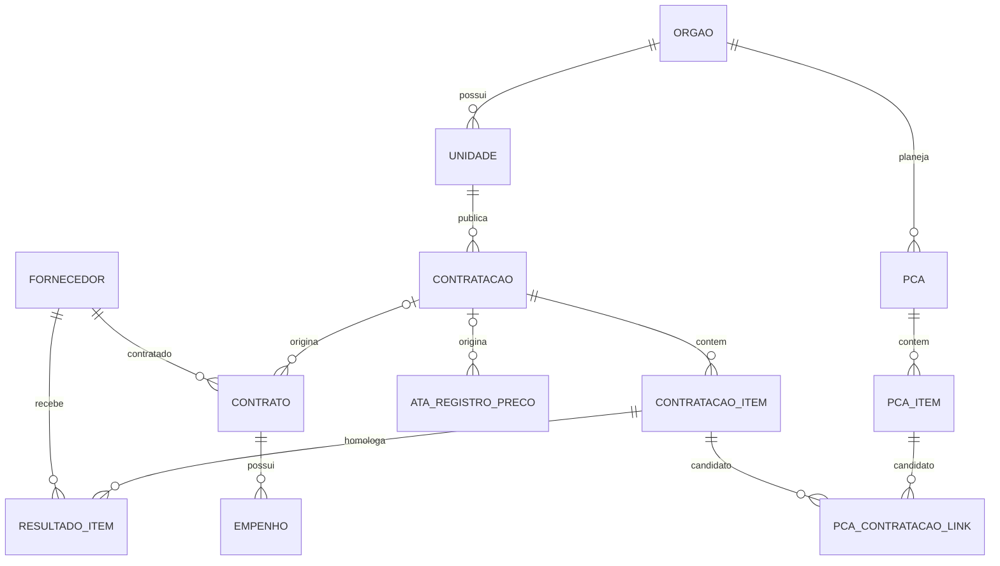

# PNCP/RJ — Fase 1: contrato de dados e modelagem normalizada

Data: 2026-10-19
Entrada: snapshot RAW encerrado na Fase 0
DDL: `migrations/100_normalized_schema.sql`
Estado: modelagem e piloto expandido do T1/2023 concluídos e validados

## 1. Objetivo e limites

A Fase 1 define a primeira versão do contrato da camada normalizada PNCP/RJ.
Ela transforma o JSON preservado na RAW em entidades relacionais adequadas
para filtros, indicadores e futuras consultas RAG.

Esta entrega não:

- modifica o banco RAW oficial;
- aplica as migrações incrementais `001` a `005`;
- executa chamadas HTTP;
- normaliza os 1.391.174 registros;
- cria associações presumidas entre PCA e contratação;
- considera ausência de empenho como evidência de inexistência.

O DDL foi desenhado para um banco SQLite independente. IDs e hashes da RAW
são armazenados como linhagem textual, sem chave estrangeira entre arquivos.

## 2. Perfil da entrada

| Recurso RAW | Registros | Identidade de negócio |
|---|---:|---|
| `contratacao` | 180.151 | `numeroControlePNCP` |
| `contratacao_item` | 557.211 | compra + `numeroItem` |
| `resultado_item` | 417.675 | compra + item + `sequencialResultado` |
| `contrato` | 151.898 | `numeroControlePNCP` do contrato |
| `empenho` | 1.900 | contrato + `sequencialEmpenho` |
| `pca` | 1.578 | `external_id`/`idPcaPncp` |
| `ata_registro_preco` | 80.761 | controle PNCP da ata |

Uma auditoria integral dos campos obrigatórios encontrou:

- nenhuma contratação sem ID, órgão, unidade, modalidade, ano ou sequencial;
- nenhum item sem pai, número ou indicador `temResultado`;
- nenhum resultado sem compra, item, sequencial ou fornecedor;
- nenhum contrato sem ID, compra-pai ou unidade;
- quatro contratos `PE` sem `niFornecedor`, preservados como
  `MISSING_IDENTIFIER` sem fabricar documento;
- nenhum empenho sem contrato, sequencial ou credor;
- nenhum PCA sem `external_id` ou itens.

## 3. Variações de formato

### PCA

Existem dois formatos reais:

1. um registro antigo com metadados no nível superior;
2. 1.577 registros com `uasg`, `unidadeResponsavel` e metadados dentro dos
   itens.

O transformador deverá:

- usar `raw_asset.external_id` como ID canônico do PCA;
- usar valores do nível superior quando presentes;
- no wrapper, derivar CNPJ, unidade, ano, datas e sequencial dos itens;
- rejeitar o PCA se os itens discordarem sobre a identidade do plano;
- carregar somente planos dentro do inventário congelado do RJ;
- registrar planos externos ou mistos em `normalization_issue`.

### Ata de registro de preços

Existem dois formatos:

| Formato | Quantidade | Campos principais |
|---|---:|---|
| Consulta ampla, formato plano | 36.597 | `numeroControlePNCPAta`, `cnpjOrgao`, `codigoUnidadeOrgao` |
| Consulta direta por compra | 44.164 | `numeroControlePNCP`, `orgaoEntidade`, `unidadeOrgao` |

Para a consulta direta, a compra-pai vem de
`query_params.numeroControlePNCPCompra`. A transformação deverá aplicar
coalescência explícita entre os dois contratos de payload, sem modificar o
JSON original.

## 4. Modelo relacional



### Tabelas de domínio

- `orgao`;
- `unidade`;
- `fornecedor`;
- `contratacao`;
- `contratacao_item`;
- `resultado_item`;
- `contrato`;
- `empenho`;
- `ata_registro_preco`;
- `pca`;
- `pca_item`;
- `pca_contratacao_link`.

### Tabelas operacionais

- `normalization_run`: execução, versão do transformador e hash do
  snapshot;
- `normalization_coverage`: cobertura por recurso e lacunas conhecidas;
- `normalization_lineage`: relação entre entidade normalizada e versão RAW;
- `normalization_issue`: rejeições, anomalias e problemas de qualidade.

## 5. Decisões de identidade

| Entidade | Chave primária |
|---|---|
| Órgão | CNPJ |
| Unidade | CNPJ do órgão + código da unidade |
| Fornecedor | tipo de pessoa + NI |
| Contratação | número de controle PNCP |
| Item | contratação + número do item |
| Resultado | contratação + item + sequencial do resultado |
| Contrato | número de controle PNCP do contrato |
| Empenho | contrato + sequencial do empenho |
| Ata | número de controle PNCP da ata |
| PCA | ID PNCP do PCA obtido do `external_id` |
| Item do PCA | PCA + número do item |

`external_id` nunca é considerado globalmente único sem o tipo de recurso
na camada RAW. Na camada normalizada, cada tipo possui sua própria tabela e
seu próprio domínio de chave.

### Precisão monetária

Todos os valores monetários são armazenados como inteiros em centavos. Somas
exploratórias com `REAL` produziram resultados divergentes nos centavos do
T1/2023. O uso de centavos elimina a imprecisão binária do SQLite e permite
reconciliação financeira exata. Quantidades e percentuais permanecem em
colunas separadas e nunca são confundidos com moeda.

## 6. Contratos cujo pai não está no recorte

Existem 3.672 contratos cuja `numeroControlePncpCompra` não está nas
contratações coletadas. O contrato não será descartado.

O modelo separa:

- `numero_controle_compra_externo`: referência original, sempre preservada;
- `contratacao_id`: FK preenchida somente quando o pai existe;
- `parent_resolution_status`: `RESOLVED`, `UNRESOLVED` ou `OUT_OF_SCOPE`.

A mesma regra é aplicada às atas.

## 7. Empenhos e cobertura parcial

`empenho.coverage_status` nasce como `PARTIAL`. A tabela
`normalization_coverage` registrará:

- 1.900 empenhos observados;
- 1.889 contratos com empenho;
- cobertura global observada de aproximadamente 1,24%;
- quatro alvos com HTTP 500 como `KNOWN_GAPS`.

Nenhuma consulta ou indicador poderá transformar a ausência de linha em
"contrato sem empenho" enquanto a cobertura não for comprovadamente completa.

## 8. Datas anômalas

Os 72 resultados com datas suspeitas serão preservados. O campo
`resultado_item.data_quality_status` permite:

- `VALID`;
- `SUSPECT_DATE`;
- `INVALID`.

A data original permanece na entidade e na RAW. A primeira versão dos
indicadores temporais deve excluir `SUSPECT_DATE` e `INVALID`, sem apagar os
registros.

## 9. PCA e contratação

`grupoContratacaoCodigo` não é uma chave PNCP garantida da contratação. Por
isso, `pca_contratacao_link` é uma associação auditável e não uma FK derivada
automaticamente.

Cada ligação deve possuir:

- método `EXPLICIT`, `RULE` ou `MANUAL`;
- confiança entre 0 e 1;
- estado `CANDIDATE`, `CONFIRMED` ou `REJECTED`;
- evidência em JSON;
- data de revisão quando aplicável.

A tabela deve permanecer vazia até existir uma regra testada e aprovada.

## 10. Linhagem e idempotência

Todas as entidades mantêm o ID e o hash da versão RAW atualmente usada.
`normalization_lineage` preserva o relacionamento completo entre:

```text
entidade normalizada
  → execução de normalização
  → raw_asset_id
  → payload_hash
  → hash do snapshot RAW
  → versão do transformador
```

A identidade da execução não integra a chave da entidade. Reexecutar o mesmo
snapshot com a mesma transformação deverá produzir o mesmo estado final.

## 11. Proteção de dados pessoais

Fornecedores pessoa física recebem `identificador_pessoal = 1`. O NI é
necessário para relacionamento no banco estruturado, mas não deverá ser
copiado para chunks, embeddings, prompts ou respostas RAG. A camada de acesso
deverá aplicar mascaramento e autorização.

## 12. Estratégia de carga futura

Ordem obrigatória:

1. iniciar `normalization_run`;
2. carregar `orgao` e `unidade`;
3. carregar `fornecedor`;
4. carregar `contratacao`;
5. carregar `contratacao_item`;
6. carregar `resultado_item`;
7. carregar `contrato` e exceções de pai;
8. carregar `empenho`;
9. carregar `ata_registro_preco`;
10. carregar PCA e itens somente dentro do inventário;
11. registrar cobertura, linhagem e problemas;
12. validar contagens, somatórios, FKs e integridade;
13. finalizar o run somente dentro da transação bem-sucedida.

Para o primeiro piloto, usar exclusivamente uma cópia do T1/2023 ou um
subconjunto determinístico em `/tmp`.

## 13. Critérios de aceite desta entrega

- [x] chaves reais identificadas nos payloads;
- [x] variações de PCA e atas documentadas;
- [x] DDL independente criado;
- [x] relacionamentos obrigatórios protegidos por FK;
- [x] pais fora do recorte preservados sem FK falsa;
- [x] cobertura parcial de empenhos representada;
- [x] datas suspeitas representadas sem alterar a RAW;
- [x] linhagem entre normalizada e RAW definida;
- [x] associação PCA×contratação não presumida;
- [x] testes do DDL em banco temporário;
- [x] transformadores centrais implementados;
- [x] piloto central do T1/2023 executado;
- [x] reconciliação de contagens e valores homologados executada;
- [x] transformadores de contrato, empenho, ata e PCA implementados;
- [x] piloto expandido do T1/2023 executado.

## 14. Resultado do piloto expandido T1/2023

Entrada somente leitura:

`data/exports/pncp_rj_raw_2023_t1.sqlite`

Saída descartável:

`/tmp/pncp_rj_normalized_2023_t1_phase1_expanded_20261019.db`

Hash SHA-256 da entrada:

`15d7097fb8c4b934dd009f68828555db1f9e7517f38d62f0f2c8421229a71800`

| Tabela | Registros normalizados |
|---|---:|
| `orgao` | 61 |
| `unidade` | 254 |
| `fornecedor` | 1.139 |
| `contratacao` | 2.024 |
| `contratacao_item` | 4.804 |
| `resultado_item` | 3.669 |
| `contrato` | 1.378 |
| `empenho` | 0 |
| `ata_registro_preco` | 0 |
| `pca` | 57 |
| `pca_item` | 25.313 |
| **Entidades** | **38.699** |
| Linhagens | 49.096 |
| Problemas informativos | 138 |

Reconciliação:

- 12.070 registros RAW examinados;
- zero rejeições;
- 138 PCAs externos ao inventário RJ ignorados de forma auditável;
- zero itens sem contratação-pai;
- zero resultados sem item-pai;
- 3.669 resultados na RAW e na normalizada;
- soma RAW de `valorTotalHomologado`: R$ 4.791.886.972,76;
- soma normalizada: R$ 4.791.886.972,76;
- soma RAW de `valorGlobal` dos contratos: R$ 201.057.100,25;
- soma normalizada dos contratos: R$ 201.057.100,25;
- soma planejada dos 57 PCAs carregados, na RAW e na normalizada:
  R$ 19.341.383.320,97;
- 1.133 contratos com compra-pai resolvida e 245 com pai fora do recorte;
- cinco fornecedores pessoa física sinalizados para proteção;
- `PRAGMA integrity_check`: `ok`;
- `PRAGMA foreign_key_check`: zero violações.

O total fornecido diretamente pelo PNCP é a referência financeira. O produto
`quantidadeHomologada × valorUnitarioHomologado` pode divergir alguns centavos
por regras de arredondamento da fonte e não deve substituir o total informado.

O snapshot trimestral não contém atas nem empenhos. Para validar esses
transformadores sem gravar na RAW oficial, todos os 80.761 payloads de atas,
os 1.900 payloads de empenhos e os 1.578 payloads de PCA da base histórica
foram transformados em memória: nenhuma incompatibilidade de formato foi
encontrada.

## 15. Próxima entrega

Antes de carregar todo o histórico, a próxima entrega deve definir o processo
operacional da normalização: seleção da versão RAW vigente, execução
incremental idempotente, atualização de linhagem e reconciliação por período.
A tabela `pca_contratacao_link` continuará vazia até a regra de associação
ser validada e aprovada.
